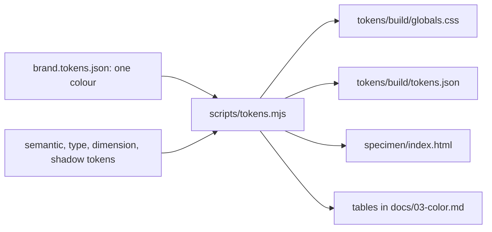

# 00. Overview

The design system for schedulink.io, the marketing site. It is deliberately not the product UI
([ADR 0001](adr/0001-marketing-not-product.md)). The app is dense because studio staff live in it all day. The site has
about eight seconds to make a studio owner feel that ScheduLink is calm, modern and built by people who understand
picture day.

## What it covers

The public site only: homepage, feature pages, pricing, about, FAQ. The app and the mobile app follow the ScheduLink
Product design system.

## How it is layered

| Layer | Lives in | Who changes it |
|---|---|---|
| The brand input, one colour | `tokens/brand.tokens.json` | A decision record, then a PR |
| The brand ramp | `tokens/palette.tokens.json` | Nobody: generated from the input |
| Roles: the names components use | `tokens/semantic.tokens.json` | A PR; brand roles alias the ramp |
| Type, spacing, radius, shadow | `tokens/typography.tokens.json`, `dimension`, `shadow` | A PR |
| Outputs for the site and the Claude design system | `tokens/build/` | Nobody: generated |
| Component guidelines and previews | `components/<Name>/` | A PR |
| The rules and why | `docs/`, `docs/adr/` | A PR; decisions as ADRs |

One build reads the token files and writes every output; CI fails if an output was not rebuilt.

## The docs

| Doc | Settles |
|---|---|
| [01 Principles](01-principles.md) | The rules that break ties |
| [02 Brand](02-brand.md) | Logo files and their rules |
| [03 Color](03-color.md) | The ramp, the roles, contrast results |
| [04 Typography](04-typography.md) | The three faces and the scale |
| [05 Layout](05-layout.md) | The page, sections, spacing, header |
| [06 Shape and elevation](06-shape-elevation.md) | Radius and shadow |
| [07 Iconography](07-iconography.md) | Line icons and benefit symbols |
| [08 Imagery](08-imagery.md) | Product illustrations and screenshot fragments |
| [09 Tokens](09-tokens.md) | Files, format, the build, syncing the Claude artifact |
| [10 Components](10-components.md) | The components and where each is used |
| [11 Content](11-content.md) | Voice and vocabulary |
| [12 Accessibility](12-accessibility.md) | Contrast, motion, states |
| [13 Roadmap](13-roadmap.md) | Open questions |
| [ADRs](adr/README.md) | One file per decision |
