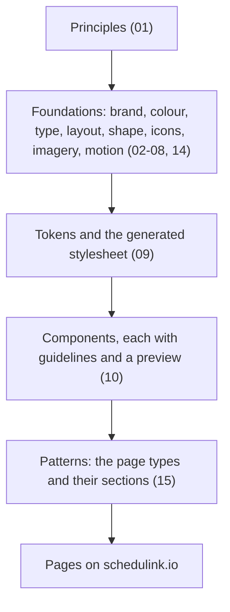
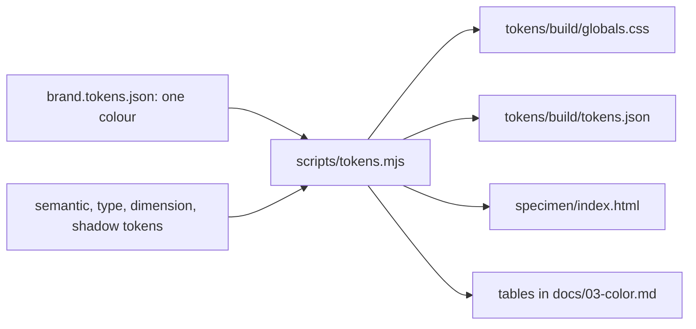

# 00. Overview

The design system for schedulink.io, the marketing site. It is deliberately not the product UI
([ADR 0001](adr/0001-marketing-not-product.md)). The app is dense because studio staff live in it all day. The site has
about eight seconds to make a studio owner feel that ScheduLink is calm, modern and built by people who understand
picture day.

## The idea: the whole studio, on the photoshoot

Most visitors have already met ScheduLink at a tradeshow booth. The site confirms that conversation and follows it up;
it is not built to be found cold. For design that means five things:

1. **Proof beats a clever line.** Every claim is a fact a visitor can check in the help center: reminders every 3 days
   up to 5 times, live in 1 to 2 weeks, $10 per active employee
   ([principle 5](01-principles.md#5-say-only-what-is-true)).
2. **A platform, not a product.** ScheduLink is shown as parts that work together on the same clients, staff and data,
   never as one linear process, one photoshoot or one season
   ([principle 2](01-principles.md#2-a-platform-not-a-product)).
3. **One idea per screen.** Big type, lots of space, each section fits one laptop screen
   ([principle 3](01-principles.md#3-one-idea-per-screen)).
4. **Switching is the fear to answer.** Studios come from several tools, so the move gets its own section and its own
   page ([principle 6](01-principles.md#6-answer-the-fear-of-switching)).
5. **The product is the proof.** Pictures are simplified true screens and story pictures with fictional data
   ([08 Imagery](08-imagery.md)).

## Who it is for

| Person | Arrives from | Device | What they need from the site |
|---|---|---|---|
| Studio owner, who is also the operations manager | A booth conversation, a card, a follow-up email | Laptop first, phone on the show floor | Confirm what they saw: one price, the parts, how the move works, a demo to book |
| Office or operations staff the owner sends the link to | A forwarded link | Laptop | How their own day changes: tasks, emails, rosters, schedules |
| A studio comparing tools | Search, a review site, a competitor's page | Laptop | What ScheduLink does that a stack of tools does not, in plain facts |
| A customer looking for help | The app or an email | Any | The help center, one click from every page |

Mid-size studios of 10 to 30 staff are the core. Every section must hold for any volume studio: schools, sports, grads,
dance and seniors.

## Surfaces

Every page is one surface with one visitor question ([15 Patterns](15-patterns.md#page-types)).

| Page | Visitor question | Type |
|---|---|---|
| Homepage | What is ScheduLink, and is it for a studio like mine? | Homepage |
| Six part pages (Photoshoot management, Task tracking, Photographer scheduling, Client relationships, Email and form automation, Online booking) | How does this part work, and what does it take off my plate? | Part page |
| Pricing | What will a studio my size pay? | Pricing |
| Switching | How hard is it to move, and who does the moving? | Switching |
| Book a demo | How do I see it with my own studio in mind? | Form |
| Contact | How do I reach a person? | Form |
| Security | Is student data safe with you? | Statement |
| About | Who is behind it? | Statement |
| Privacy, Terms | The legal text | Legal |

## How it is layered

Each layer builds only on the layers above it.

| Layer | Lives in | Who changes it |
|---|---|---|
| The brand input, one colour | `tokens/brand.tokens.json` | A decision record, then a PR |
| The brand ramp | `tokens/palette.tokens.json` | Nobody: generated from the input |
| Roles: the names components use | `tokens/semantic.tokens.json` | A PR; brand roles alias the ramp |
| Type, spacing, radius, shadow | `tokens/typography.tokens.json`, `dimension`, `shadow` | A PR |
| Outputs for the site and the Claude design system | `tokens/build/` | Nobody: generated |
| Component guidelines and previews | `components/<Name>/` | A PR |
| The rules and why | `docs/`, `docs/adr/` | A PR; decisions as ADRs |

One build reads the token files and writes every output; CI fails if an output was not rebuilt.

## The docs

| Doc | Settles |
|---|---|
| [01 Principles](01-principles.md) | Eight rules that break ties, and the objections they answer |
| [02 Brand](02-brand.md) | Logo files and their rules |
| [03 Color](03-color.md) | The ramp, the roles, contrast results |
| [04 Typography](04-typography.md) | The three faces and the scale |
| [05 Layout](05-layout.md) | The page, breakpoints, grids, the homepage, spacing |
| [06 Shape and elevation](06-shape-elevation.md) | Radius, shadow, states |
| [07 Iconography](07-iconography.md) | Line icons and benefit symbols |
| [08 Imagery](08-imagery.md) | The hero, tab pictures, story pictures, screenshot fragments |
| [09 Tokens](09-tokens.md) | Files, format, the build, syncing the Claude artifact |
| [10 Components](10-components.md) | The components and where each is used |
| [11 Content](11-content.md) | Voice, tone by page, vocabulary, formats |
| [12 Accessibility](12-accessibility.md) | Contrast, keyboard, motion, images |
| [13 Roadmap](13-roadmap.md) | Versions, decisions, open calls |
| [14 Motion](14-motion.md) | What moves, how fast, and reduced motion |
| [15 Patterns](15-patterns.md) | The site map, page types and the sections each is built from |
| [ADRs](adr/README.md) | One file per decision |

## Scope of version 0.2

| In | Out, for later |
|---|---|
| Principles, foundations, tokens, the generated stylesheet | Component code: the engineers build it in React |
| Ten components with guidelines and previews | A Figma library |
| Patterns for every launch page | Blog, comparison page with Airstudio, FAQ page |
| Content, accessibility and motion rules | Motion tokens ([13 Roadmap](13-roadmap.md#not-built-yet)) |
| A specimen page for review | Vector logo files |
