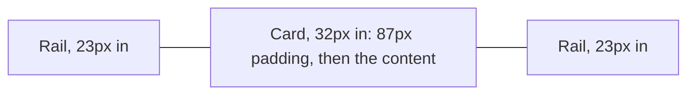

# 05. Layout and spacing

A soft grey page with white cards floating on it.

## The page

- **Ground:** `page-grey` (#F3F3F4). Sections are white cards with 24px corners (`radius-card`) and a 1px `line` border,
  inset 32px from the page edges on desktop and 12px on phones, with 87px of padding at each side inside the card and
  20px on phones: the same edges as the homepage (Seenu, 2026-10-25).
- **Some sections sit straight on the grey** to vary the rhythm: the logo row, the benefits, testimonials and the FAQ.
- **Between sections:** a 64px grey gap (32px on phones) with a thin line across the full page width and a small + where it meets the side
  rails. The rails are 1px lines 23px in from each page edge, running from under the header to the bottom.
- **Header:** plain white, full width, a hairline underneath, fixed to the top while the page scrolls. Not floating, not
  rounded, not inset.
- **Every page** has the same ground, side rails, section lines with + marks, and the footer on the grey (Seenu,
  2026-10-27). The footer is a light block: blue wordmark, four link columns, a hairline, then address, social links and
  the copyright line. No dark band.

## Breakpoints

The site is designed at 1440px and checked from 390px to 1512px. Every page reflows down to 320px with nothing lost and
no sideways scrolling.

| Width | What changes |
|---|---|
| 1440px and wider | The design: content stops at 1440px and the grey runs on either side |
| 1300px and below | Pictures scale down inside their cards |
| 1199px and below | Header padding drops to 48px; the part page hero text narrows to 380px and its picture scales further |
| 1000px and below | The header hides its middle links; the homepage goes to one column |
| 900px and below | Every other page goes to one column, text above picture, and phone pictures replace desktop ones |
| 760px and below | Phones: the rails go, cards sit 12px from the edge with 20px padding, the header is 64px with a 120px wordmark, the footer columns go two by two |

Phone pictures are drawn for phones, never a desktop picture scaled down ([08 Imagery](08-imagery.md)).

## Grids

| Block | Desktop | Phone |
|---|---|---|
| Header | 80px tall, 120px padding at each side | 64px tall, 16px padding, wordmark and Schedule a demo only |
| Part page hero | Text column 500px, picture beside it | Text, then the picture |
| How it works block | 420px text column, a 72px gap, the picture filling the rest; sides alternate | Text, then the picture |
| Benefits | Three columns | One column |
| Integrations | Two by two, divided by thin lines | One column |
| Footer | Four link columns | Two by two |

Text columns stop at about 68 characters a line ([04 Typography](04-typography.md#rules)).

## The homepage

The brand book fixes the hero, then the logo row, then the benefits. It names the other section tags in this order but does not state the full page order, so the order below past the benefits is the order of those tags, not a decision.

| Section | Tag | Notes |
|---|---|---|
| Hero | none | Two-line headline, `display-xl` then `display-sub` ([04](04-typography.md)), the hero illustration ([08](08-imagery.md)) |
| Logo row | none | On the grey |
| Benefits | none | On the grey, three columns, each a BenefitSymbol, a 28px headline, one line. Benefits only, never features. In order: admin that stays the same as the studio grows, a team that always knows its part, clients who come back every season |
| Platform | THE PLATFORM | "One system instead of a stack of apps." Then the platform tabs |
| Integrations | INTEGRATIONS | A 2 by 2 grid divided by thin lines; logo (56px tall on desktop, 44px on phones) above name, no description; the last cell "More on the way" |
| Testimonials | TESTIMONIALS | On the grey |
| Switching | SWITCHING | |
| FAQ | FAQ | On the grey |
| Closing call to action | none | The only centred heading |

Headings are always left-aligned under their tag; only the closing call to action is centred.

Each section fits one laptop screen at full size: about 750px tall at 1440px wide (Seenu, 2026-10-20). An FAQ shows its questions with the answers closed. A row with no heading that sits straight on the grey, like the logo row or the benefits, uses 48px (`space-7`) above and below instead (Seenu, 2026-10-27).

The header stays at the top of the screen while the page scrolls (Seenu, 2026-10-20).

## Platform tabs

One tab per part, in this order: Photoshoot management, Task tracking, Photographer scheduling, Client relationships,
Email and form automation, Online booking. The footer's Platform column lists the same names in the same order.

- Each tab: a small mono label, a headline, one line, a "Learn more" link, and a large picture.
- Tab headings share one shape: what the part handles, a comma, then the problem gone, in plain literal words, 5 to 9
  words, each with a different problem word: "never scattered again", "nothing slips", "without calling around", "no
  retyping", "none sent by hand", "not chased".
- The line under it says how it works, in plain facts the help center confirms.
- No proof card, "Also" line or "Linked to" chips under it: the picture carries the proof.
- A part that is not live gets a grey "Coming soon" label and a placeholder picture at the same size; when it ships it
  switches to a blue "New" label for its first months.
- Adding a part means adding a tab; nothing else changes.

## Spacing

| Token | Value | Use |
|---|---|---|
| `space-1` | 4px | Between a marker dot and its label |
| `space-2` | 8px | Inside chips, between stacked list items |
| `space-3` | 12px | Button padding, between a heading and its eyebrow |
| `space-4` | 16px | Between a heading and its paragraph |
| `space-5` | 24px | Card padding and gutters on phones |
| `space-6` | 32px | Card padding on desktop, between cards |
| `space-7` | 48px | Between a section header and its content |
| `space-8` | 80px | Section padding at the top and bottom of a card, on desktop and phones |
| `space-9` | 120px | Large gaps between blocks inside a section |
