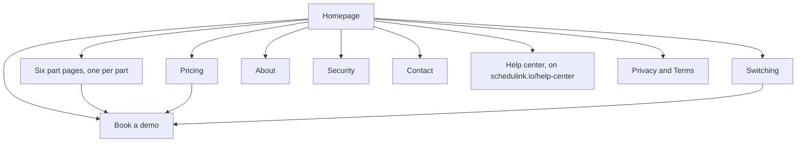
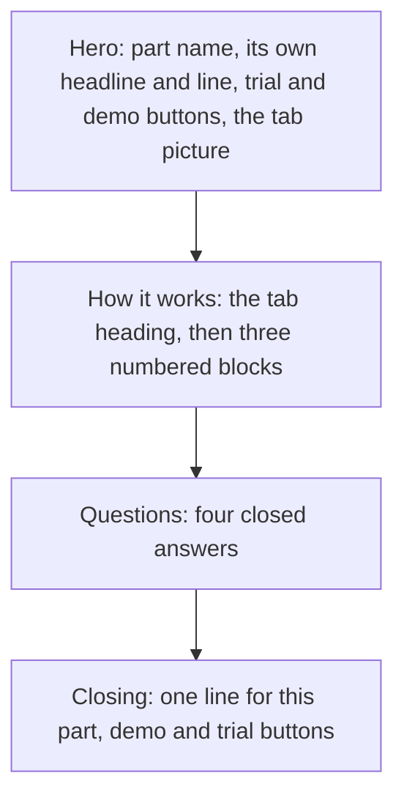

# 15. Patterns

How sections combine into the pages of schedulink.io. Every pattern follows
[principle 3](01-principles.md#3-one-idea-per-screen): one idea per section, one heading, one picture.

## The site map

Every page leads to a demo. Book a demo is the one page every other page points at.

| Need | Where it lives |
|---|---|
| What ScheduLink is | The homepage hero |
| How one part works | Its part page, reached from the Platform menu, the homepage tabs and the footer |
| What it costs | The pricing page only; the homepage shows no price, only "30-day free trial, no credit card." |
| How the move works | The homepage Switching section, then the Switching page |
| A detailed how-to | The help center, which opens in a new tab |

## Page types

| Type | Sections, in order | Pages |
|---|---|---|
| Homepage | Hero, logo row, benefits, platform, integrations, testimonials, switching, questions, closing | Homepage ([05 Layout](05-layout.md#the-homepage)) |
| Part page | Hero, How it works, Questions, Closing | The six parts |
| Coming soon | Hero only, with "Coming soon" and no trial button | Online booking until it ships |
| Pricing | Hero with the price card, the team-size slider, Included, Questions, Closing | Pricing |
| Switching | Hero, what moves where, the four steps, the four worries, Questions, Closing | Switching |
| Form | Hero with what to expect on the left, the form on the right | Book a demo, Contact |
| Statement | Hero, three or four promises, one detail section, Closing | About, Security |
| Legal | A heading and plain sections, no pictures | Privacy, Terms |

Every page has the same header, ground, side rails, section lines with + marks, and the light footer
([05 Layout](05-layout.md#the-page)). There are no pop-ups, no chat bubbles and no cookie walls that cover the page.

## Header

| Left | Middle | Right |
|---|---|---|
| The wordmark, linking home | Platform ▾ (the six parts, Online booking marked "Coming soon"), Pricing, About, Help center | Log in, Start free trial, Schedule a demo |

- Schedule a demo is the only solid button in the header.
- Help center opens in a new tab; everything else stays in the site.
- On phones only the wordmark and Schedule a demo stay visible.
- The header is fixed to the top on every page.

## Footer

The light footer on the grey: the blue wordmark, four link columns, a hairline, then the address, social links, the
copyright line and one line naming each third-party trademark owner.

| Platform | Company | Resources | Legal |
|---|---|---|---|
| The six parts, in the tab order | About, Blog, Contact | Help center, Switching, Security, Book a demo | Privacy, Terms |

The Platform column is the way from one part page to the others.

## Part page

One template for every part, so a seventh part is a day's work: only How it works changes from part to part
(Seenu, 2026-10-16 and 2026-10-22).

| Section | What it holds | Rules |
|---|---|---|
| Hero | Tag with the part's name, a `display-m` headline, one line, Start free trial and Schedule a demo, "30-day free trial, no credit card.", the part's tab picture | The headline states the part's whole job, not one mechanism, and never repeats the tab copy |
| How it works | Tag "How it works", the tab heading as `display-s`, then three blocks | Each block: a mono tag "01 · Word", a `heading` title, one or two lines, a story picture. Text and picture alternate sides. The three tags read as one arc, such as Created, Done, Tracked |
| Questions | Tag "Questions", "Asked at the booth.", four questions with answers closed, a link to the help center | One question is about moving over from what the studio uses now |
| Closing | One heading naming the part ("Track every task in ScheduLink."), demo and trial buttons | The only centred heading on the page |

The hero picture is the part's tab picture, the true app simplified. The How it works pictures are story pictures
([08 Imagery](08-imagery.md#story-pictures)).

## Coming soon

A part that is not live gets a one-section page: the tag with a grey "Coming soon" label, the headline and line, "Ask
us about it" and Schedule a demo, and a line on price. No trial button, since the part cannot be tried yet. When it
ships, it becomes a full part page and its tab label turns to a blue "New" for its first months.

## Pricing

| Section | What it holds |
|---|---|
| Hero | "One price for the whole studio.", the line, trial and demo buttons, and the price card: $10 per active employee, per month, with every part listed |
| Your studio | A slider for people with a login and the monthly total beside it ($200 a month for 20) |
| Included | Three items: every part, setup and import, help |
| Questions | Contract, who counts, the card for the trial, online booking |
| Closing | Trial and demo buttons |

Rules: one price, no tiers, no discounts, no "contact sales". Who counts is said in the words studios use: office staff,
photographers and editors with a login count; clients never do.

## Switching

| Section | What it holds |
|---|---|
| Hero | "Move the whole studio over in 1 to 2 weeks, and we do the moving." |
| Several tools, one move | A two-column table: what you use now, and the part that takes its place. Tools that stay (Google Calendar, Outlook, Netlife) are named as staying |
| From demo to your first photoshoot | Four steps in order: Demo, Send your data, Setup call, Your first photoshoot |
| Every worry, answered | Four rows: Your data, Your team, Mid-season, Help |
| Questions, Closing | As on every page |

The four steps are the one place the site shows a sequence, because the move is one. The product itself is never shown
as steps ([principle 2](01-principles.md#2-a-platform-not-a-product)).

## Forms

Book a demo and Contact share one shape: what to expect on the left, the form on the right, stacked on phones.

| Rule | Book a demo | Contact |
|---|---|---|
| Fields | Your name, work email, studio name, team size (1 to 9, 10 to 30, 31 to 60, more than 60), where did we meet (optional) | Your name, work email, studio name (optional), message |
| Promise beside the form | 45 minutes, against how your studio works, bring whoever needs to see it | A reply within 24 hours |
| After sending | Pick a time | Not drawn yet |

- Labels sit above fields and stay visible. Optional fields say "(optional)"; nothing is marked with a star.
- "Where did we meet?" is how a booth conversation is picked up again.
- No phone number field, no job title, no "how did you hear about us" beyond the show.

## Statement pages

About and Security make promises, so each promise is a short heading the reader can hold the company to, with one or
two lines under it.

| Page | Promises | Detail section |
|---|---|---|
| About | We say what it does; we do the moving; we answer; we don't lock you in | The team: name, area, one line each |
| Security | Rosters never sit in an inbox; your team sees what you let them; every change is recorded; your data stays yours | Where your data lives (statement to come from Seenu) |

## Questions

The same section on every page that has one.

- Tag "Questions", then a heading in the page's voice ("Asked at the booth.", "Pricing questions.").
- Four questions, answers closed, each opened by its own row. A plus turns to a minus.
- Answers are one or two sentences of fact, and end with a link to the help center when there is more.

## Closing

The last section on every page except Form and Legal pages: one heading, one line at most, Schedule a demo and Start
free trial, and "30-day free trial, no credit card." It is the only centred heading on the site.
