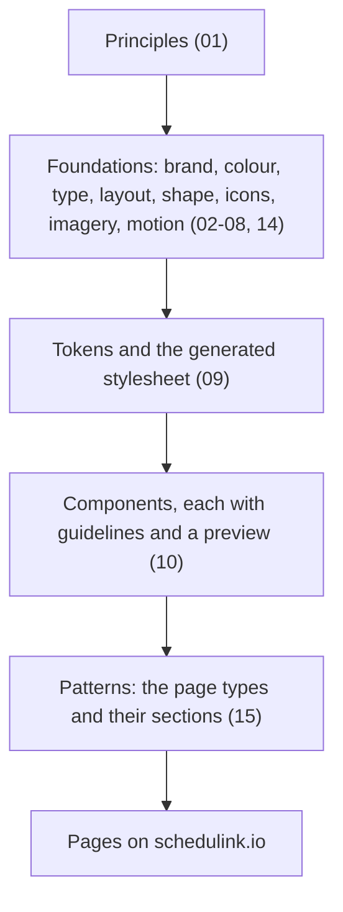
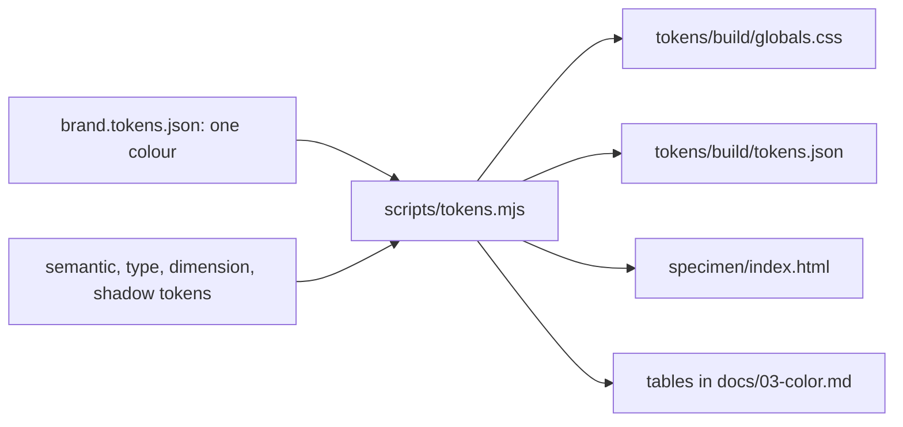
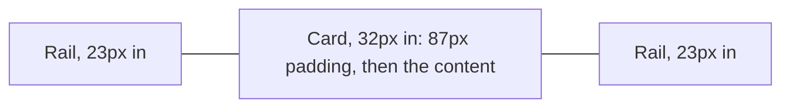
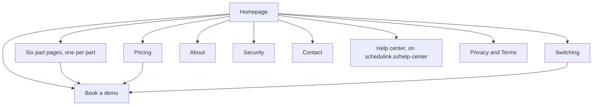
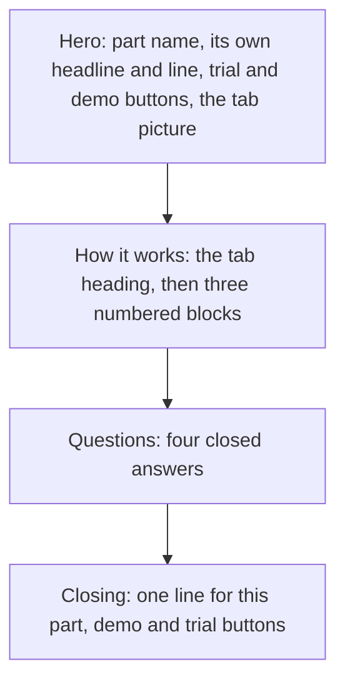

# ScheduLink Marketing


GENERATED from docs/ in github.com/seenu-yellapu/schedulink-design by scripts/tokens.mjs. Change the rules there, not here.

## 00. Overview

The design system for schedulink.io, the marketing site. It is deliberately not the product UI
(ADR 0001). The app is dense because studio staff live in it all day. The site has
about eight seconds to make a studio owner feel that ScheduLink is calm, modern and built by people who understand
picture day.

### The idea: the whole studio, on the photoshoot

Most visitors have already met ScheduLink at a tradeshow booth. The site confirms that conversation and follows it up;
it is not built to be found cold. For design that means five things:

1. **Proof beats a clever line.** Every claim is a fact a visitor can check in the help center: reminders every 3 days
   up to 5 times, live in 1 to 2 weeks, $10 per active employee
   (principle 5).
2. **A platform, not a product.** ScheduLink is shown as parts that work together on the same clients, staff and data,
   never as one linear process, one photoshoot or one season
   (principle 2).
3. **One idea per screen.** Big type, lots of space, each section fits one laptop screen
   (principle 3).
4. **Switching is the fear to answer.** Studios come from several tools, so the move gets its own section and its own
   page (principle 6).
5. **The product is the proof.** Pictures are simplified true screens and story pictures with fictional data
   (08 Imagery).

### Who it is for

| Person | Arrives from | Device | What they need from the site |
|---|---|---|---|
| Studio owner, who is also the operations manager | A booth conversation, a card, a follow-up email | Laptop first, phone on the show floor | Confirm what they saw: one price, the parts, how the move works, a demo to book |
| Office or operations staff the owner sends the link to | A forwarded link | Laptop | How their own day changes: tasks, emails, rosters, schedules |
| A studio comparing tools | Search, a review site, a competitor's page | Laptop | What ScheduLink does that a stack of tools does not, in plain facts |
| A customer looking for help | The app or an email | Any | The help center, one click from every page |

Mid-size studios of 10 to 30 staff are the core. Every section must hold for any volume studio: schools, sports, grads,
dance and seniors.

### Surfaces

Every page is one surface with one visitor question (15 Patterns).

| Page | Visitor question | Type |
|---|---|---|
| Homepage | What is ScheduLink, and is it for a studio like mine? | Homepage |
| Six part pages (Photoshoot management, Task tracking, Photographer scheduling, Client relationships, Email and form automation, Online booking) | How does this part work, and what does it take off my plate? | Part page |
| Pricing | What will a studio my size pay? | Pricing |
| Switching | How hard is it to move, and who does the moving? | Switching |
| Book a demo | How do I see it with my own studio in mind? | Form |
| Contact | How do I reach a person? | Form |
| Security | Is student data safe with you? | Statement |
| About | Who is behind it? | Statement |
| Privacy, Terms | The legal text | Legal |

### How it is layered



Each layer builds only on the layers above it.

| Layer | Lives in | Who changes it |
|---|---|---|
| The brand input, one colour | `tokens/brand.tokens.json` | A decision record, then a PR |
| The brand ramp | `tokens/palette.tokens.json` | Nobody: generated from the input |
| Roles: the names components use | `tokens/semantic.tokens.json` | A PR; brand roles alias the ramp |
| Type, spacing, radius, shadow | `tokens/typography.tokens.json`, `dimension`, `shadow` | A PR |
| Outputs for the site and the Claude design system | `tokens/build/` | Nobody: generated |
| Component guidelines and previews | `components/<Name>/` | A PR |
| The rules and why | `docs/`, `docs/adr/` | A PR; decisions as ADRs |



One build reads the token files and writes every output; CI fails if an output was not rebuilt.

### The docs

| Doc | Settles |
|---|---|
| 01 Principles | Eight rules that break ties, and the objections they answer |
| 02 Brand | Logo files and their rules |
| 03 Color | The ramp, the roles, contrast results |
| 04 Typography | The three faces and the scale |
| 05 Layout | The page, breakpoints, grids, the homepage, spacing |
| 06 Shape and elevation | Radius, shadow, states |
| 07 Iconography | Line icons and benefit symbols |
| 08 Imagery | The hero, tab pictures, story pictures, screenshot fragments |
| 09 Tokens | Files, format, the build, syncing the Claude artifact |
| 10 Components | The components and where each is used |
| 11 Content | Voice, tone by page, vocabulary, formats |
| 12 Accessibility | Contrast, keyboard, motion, images |
| 13 Roadmap | Versions, decisions, open calls |
| 14 Motion | What moves, how fast, and reduced motion |
| 15 Patterns | The site map, page types and the sections each is built from |
| ADRs | One file per decision |

### Scope of version 0.2

| In | Out, for later |
|---|---|
| Principles, foundations, tokens, the generated stylesheet | Component code: the engineers build it in React |
| Ten components with guidelines and previews | A Figma library |
| Patterns for every launch page | Blog, comparison page with Airstudio, FAQ page |
| Content, accessibility and motion rules | Motion tokens (13 Roadmap) |
| A specimen page for review | Vector logo files |


## 01. Principles

Eight rules that decide arguments. When two of them conflict, the one higher in
the tie-break order wins.

### 1. Calm beats loud

Simple and plain: Apple-clean with a little fun. A grey page, white cards, big type and generous space.

- Section padding of 80px keeps each section to one laptop screen (05 Layout).
- Headings are short and literal. Size and weight carry hierarchy, not colour.
- A little fun lives in the product pictures (faces, a date tile, a small loop), never in the page chrome.

Watch for: corporate and cold, playful and cheap, busy, looking like everyone else.
Decision: ADR 0001.

### 2. A platform, not a product

ScheduLink runs the whole studio, like HubSpot or Procore. It is a set of parts that work together, each useful on its
own, all sharing the same clients, staff and data.

- The homepage shows the parts as a set (the platform tabs), not as step 1, step 2, step 3.
- Every section holds for any volume studio: schools, sports, grads, dance and seniors.
- A new part is a new tab, a new page from the part page template and a new footer link. Nothing else changes
  (15 Patterns).

Watch for: a linear process, a single photoshoot, a single season, a section that breaks when an eighth part arrives.

### 3. One idea per screen

Every section makes one point, with one heading, one line and one picture.

- A section fits one laptop screen at full size: about 750px tall at 1440px wide.
- An FAQ shows its questions with the answers closed.
- Two ideas on one screen means one of them moves or goes, as the "Part of the whole studio" section did.

Watch for: two headings in one section, side-by-side ideas, a picture that needs a caption.

### 4. One colour carries meaning

Blue only where the visitor acts or the brand appears. No second accent.

- Buttons, links, the selected tab, section tags, the badge on a benefit symbol (03 Color).
- Urgency is weight, position and words, never a new hue.

Watch for: blue icons outside product pieces, tinted decoration, a second accent.
Decision: ADR 0002.

### 5. Say only what is true

Proof and specificity beat a clever headline. Every claim matches the help center.

- The app flags scheduling conflicts; it does not prevent them, so the site says flags.
- Permissions are per area, not per client.
- Numbers are the published ones: reminders every 3 days up to 5 times, live in 1 to 2 weeks, $10 per active employee
  per month, a 30-day trial with no card.
- Consolidation is said concretely: open a picture day and the school, schedule, photographers, roster form, emails and
  tasks are on that one photoshoot.

Watch for: "all in one place", "unify", "streamline", "seamless", "everything your studio needs", and any line
Airstudio could run on its homepage tomorrow (11 Content).

### 6. Answer the fear of switching

Studios lose deals to a stack of tools, and moving off several tools means several migrations. The fear is the
objection, not the price.

- Switching has its own homepage section and its own page, not a line in an FAQ.
- Each part page has one question on switching in its Questions section.
- The answers are concrete: who moves the data, how long it takes, what happens mid-season, who to ask.

Watch for: "easy to switch" with nothing behind it, the move tucked into a footnote.

### 7. The page is flat; the product has depth

The product is the proof, so the pictures carry the detail and the page stays quiet.

- No shadows on sections, cards, buttons or panels. Structure comes from hairlines and tinted panels.
- Only the hero illustration gets `shadow-product`; screenshot fragments and tab pictures have none
  (0011, 0012).
- Pictures are simplified true screens and story pictures with fictional schools and people. No stock photos, no blobs
  (08 Imagery).

Watch for: drop shadows, gradients, glow, frosted glass, a real client's or student's name.
Decisions: ADR 0005, ADR 0006.

### 8. Readable for everyone

Text clears 4.5:1 on its ground and brand text 7:1; the build checks every pair.

- Nothing below 13px in a picture, and no meaning by colour alone (12 Accessibility).
- Product loops stop when the visitor asks for reduced motion (14 Motion).

Decision: ADR 0007.

### Objections we answer

Each objection heard at the booth has a place on the site.

| Objection | The site's answer | Where |
|---|---|---|
| Moving our data means retyping it | We import it before your setup call | Switching |
| My team will not learn another tool | Photographers get their week by email and text and answer from their dashboard | Switching |
| We cannot change mid-season | Start with the part you need most and add the rest when ready | Switching |
| Who helps when it breaks | The assistant inside the app, and email answered within 24 hours | Switching |
| We already have a tool for each job | Each tool has a part that takes its place, so the move happens once | Switching |
| It costs more than what we have | One published price per active employee, with every part included | Pricing |
| Is student data safe | Four plain promises and where the data lives | Security |

### When principles conflict

| Order | Principle | Why it ranks here |
|---|---|---|
| 1 | Say only what is true | A false claim costs the trust the booth earned |
| 2 | Readable for everyone | Its floors (contrast, 13px, words with colour) never give way |
| 3 | A platform, not a product | The positioning; a section that breaks it is wrong |
| 4 | Answer the fear of switching | The objection that decides the deal |
| 5 | One idea per screen | What keeps the page plain |
| 6 | The page is flat; the product has depth | The look |
| 7 | One colour carries meaning | The look |
| 8 | Calm beats loud | The first to give way, for a little fun |

### Tried and rejected

Grid strips between sections, nodes, the dark footer, the floating rounded header, black buttons, a tile pattern behind
the closing call to action, icon plates with corner dots, a statement band ("Everything scheduled. Everything
linked."), a "What is ScheduLink?" section, a problem section, the small-feature grid, a "Part of the whole studio"
section on part pages. Gradients, glassmorphism and a blue-purple glow are out as well.


## 02. Brand

ScheduLink, capital L, everywhere, including meta titles and the help center. The wordmark sets the spelling.

### Logo files

The official files, at full resolution, in `brand/logo/`. Never redraw, recolour or crop them.

| Use | File |
|---|---|
| Default, on white or light grounds | `brand/logo/wordmark-blue.png` |
| On brand, dark bands and the footer | `brand/logo/wordmark-white.png` |
| Single-colour print or partner decks | `brand/logo/wordmark-black.png` |
| Favicon, app icon, avatars | `brand/logo/icon-blue.png` |
| Icon on dark or blue | `brand/logo/icon-white.png` |
| Icon, single colour | `brand/logo/icon-black.png` |
| Pre-composed on a blue ground | `brand/logo/wordmark-on-blue.png`, `brand/logo/icon-on-blue.png` |

Prefer the transparent files and let the ground come from a token. The wordmarks are 5003 by 1406 px, the icons 512
by 512 px. There are no vector files in this repo yet (13 Roadmap).

### Rules

- Wordmark in the nav at 150px wide (about 42px tall) on every page, with clear space of at least the height of the S on every side.
- Minimum wordmark width 120px; below that, use the icon.
- Never recolour it, never add a shadow, never put the blue wordmark on a mid-tone ground. On anything darker than
  `surface-sunken`, switch to the white file.
- The icon alone is for favicons, avatars and square placements. On the website, use the wordmark.
- Brand blue is `#2A5BD7`, taken from the files themselves. It is the one input of the brand family
  (03 Color).

### Third-party logos

The official, current files only, never redrawn, recoloured or cropped. Always next to the product's name, and the copy
only says ScheduLink works with the tool, never that it is a partner. A small line in the footer names each trademark
owner. Spell partners as they do: Netlife, not NetLife.


## 03. Color

The site is near-monochrome: a grey page, white cards, greys, one house dark and the ScheduLink blue. There is no
second accent colour (ADR 0002). Values live in `tokens/`; this doc explains them. The
tables marked as generated are written by `node scripts/tokens.mjs`, so they always match the tokens.

### Where blue is allowed

The logo, buttons, links, the selected tab, section tags, the "New" label on a tab, product-card accents and the badge
on a benefit symbol. Never on decoration, never on icons outside product pieces, never on large fills.

Attention states use `attention`: a neutral panel with `ink` text and a 3px `ink` rule. Urgency is carried by weight,
position and words, not by hue.

### The brand family from one colour

One input, `brand.input` in `tokens/brand.tokens.json`, produces a twelve-step ramp in OKLCH
(ADR 0009). Each step has a fixed job:

| Steps | Job |
|---|---|
| 1 to 2 | Backgrounds |
| 3 to 5 | Tints: resting, hovered, selected |
| 6 to 8 | Borders: subtle, normal, strong |
| 9 | The solid: the input itself, unchanged |
| 10 | The solid pressed or hovered |
| 11 | Text in the brand hue |
| 12 | The darkest step |

How each step is found:

1. Steps 1 to 8 sit at fixed lightness targets, with chroma rising toward step 9 as a fixed share of the input's chroma.
2. Step 9 is the input, kept exactly as long as white text on it reaches 4.5:1. If a future input fails, the build
   darkens it until it passes and stops with an error, so the change is never silent.
3. Step 10 moves away from the white label, so a hovered button never loses contrast.
4. Step 11 is searched, not set: the lightest value that reaches 7:1 on white, `page-grey`, `surface-sunken` and step
   3. Brand-coloured text is read at small sizes, so it gets the stricter target.

| Step | Role | Value | OKLCH |
|---|---|---|---|
| 1 | App background | `#FCFDFF` | oklch(99.4% 0.003 264.5) |
| 2 | Subtle background | `#F6F9FF` | oklch(98.2% 0.009 264.5) |
| 3 | Element tint | `#EBF2FF` | oklch(96.0% 0.019 263.0) |
| 4 | Hovered tint | `#E1EBFF` | oklch(93.9% 0.029 264.4) |
| 5 | Selected tint | `#D1E0FF` | oklch(90.5% 0.046 264.9) |
| 6 | Subtle border | `#BDD2FE` | oklch(86.3% 0.066 265.0) |
| 7 | Border | `#A3C1FD` | oklch(81.1% 0.091 263.9) |
| 8 | Strong border | `#81A7F8` | oklch(73.4% 0.125 264.4) |
| 9 | Solid | `#2A5BD7` | oklch(51.6% 0.198 264.2) |
| 10 | Pressed solid | `#1A48C2` | oklch(45.6% 0.197 264.1) |
| 11 | Brand text | `#1E48B5` | oklch(44.5% 0.179 264.2) |
| 12 | Darkest | `#09205A` | oklch(27.0% 0.108 264.0) |

### Roles

Components use these names, never ramp steps. Five roles follow the ramp; every other value is set by hand, as the
ScheduLink Marketing system set it.

| Role | Value | Source | Use |
|---|---|---|---|
| `surface` | `#FFFFFF` | set by hand | Default page background. Most of the site sits on this. |
| `surface-sunken` | `#F7F7F8` | set by hand | Alternating section bands. Never two sunken bands in a row. |
| `surface-raised` | `#FFFFFF` | set by hand | Cards and panels. On light they need a line border to read, since there are no shadows. |
| `surface-invert` | `#2F2F2F` | set by hand | Reserved. The footer sits on the grey, not on a dark band (Seenu, 2026-10-27), so nothing on the site uses this yet. |
| `ink` | `#2F2F2F` | set by hand | The house dark. Headlines and primary text. |
| `ink-secondary` | `#585A5E` | set by hand | Body copy and supporting paragraphs. |
| `ink-muted` | `#6B6E73` | set by hand | Eyebrow labels, captions, metadata. Never body copy. |
| `brand` | `#2A5BD7` | brand.9 | The ScheduLink blue, from the logo. Buttons, links, active states and the mark itself. Nothing decorative. |
| `brand-strong` | `#1E48B5` | brand.11 (was `#1F43A8`) | Link text on light grounds and primary button hover. |
| `brand-soft` | `#EBF2FF` | brand.3 (was `#ECEFFA`) | Tint behind a positive status chip or an active nav item. Text on it is brand-strong. |
| `on-brand` | `#FFFFFF` | set by hand | Text and icons on brand fills. |
| `attention` | `#EFEFF1` | set by hand | Ground for anything that needs attention: a conflict flag, an overdue chip, a roster still outstanding. Neutral by design, with ink text and a 3px ink rule carrying the emphasis instead of a colour. |
| `line` | `#E6E6E8` | set by hand | Hairline borders, section rules, table dividers. Structure comes from these, not from shadows. |
| `line-strong` | `#8A8C91` | set by hand | Input and control borders, secondary button outlines, focus rings. |
| `page-grey` | `#F3F3F4` | set by hand | The page ground. Sections float on it as white cards. |
| `status-overdue-bg` | `#FDE8E8` | set by hand | Overdue status pill background. |
| `status-overdue-text` | `#B42318` | set by hand | Overdue status pill text. |
| `status-today-bg` | `#F2ECFC` | set by hand | Due-today status pill background. Purple is used for due-today only. |
| `status-today-text` | `#6A3FBF` | set by hand | Due-today status pill text. |
| `status-later-bg` | `#EBF2FF` | brand.3 (was `#EEF2FC`) | Due-later status pill background. |
| `status-later-text` | `#1E48B5` | brand.11 (was `#1F43A8`) | Due-later status pill text. |
| `illus-rim` | `#F3F3F5` | set by hand | Soft rim around product illustrations. |
| `illus-rim-line` | `#E6E6E9` | set by hand | Border of the soft rim. |
| `illus-header-rule` | `#DCDDE1` | set by hand | Line under column headers in product illustrations. |
| `illus-placeholder` | `#ECECF0` | set by hand | Placeholder lines and pills in simplified rows. |
| `illus-shootcard` | `#F6F9FF` | brand.2 (was `#F4F6FB`) | Shoot card background in the Photographers column. |
| `illus-shootcard-line` | `#E1EBFF` | brand.4 (was `#E6EBF6`) | Shoot card border. |
| `illus-tile-line` | `#E1EBFF` | brand.4 (was `#DBE4FA`) | Border of the pale blue column-header tile in product illustrations. The tile itself is brand-soft. |
| `illus-date` | `#EBF2FF` | brand.3 | Date tile and part tile fill in tab pictures. |
| `illus-date-line` | `#D1E0FF` | brand.5 | Border of the date tile in tab pictures. |
| `symbol-line` | `#E3E3E7` | set by hand | Border of the white tile behind a benefit symbol. |
| `confirm` | `#2C9A4B` | set by hand | The green tick badge on a benefit symbol. Shapes only, always with a tick, never text. |
| `grid-line` | `#EBEBEE` | set by hand | Lines of the background grid behind homepage sections (Seenu, 2026-10-20). |
| `grid-node` | `#B3B5B9` | set by hand | Dots where background grid lines meet. |
| `grid-mark` | `#9FA1A6` | set by hand | Corner cross marks on section edges. |

### Status colours

Used inside product illustrations only: red for overdue, purple for due today (its only use on the site), blue for due
later or scheduled, green for done or accepted, amber for waiting on a reply (scheduling only, always with the word
"Waiting"). A state is never shown by hue alone: a confirmed row gets a tick as well as green.

### Contrast

Every pair below is checked by the build (ADR 0007). Body text needs 4.5:1 on its
ground, brand text 7:1, control borders, icons and badge shapes 3:1.

| Text or shape | On | Ratio | Needs | Result |
|---|---|---|---|---|
| `ink` | `surface` | 13.39:1 | 4.5:1 | Pass |
| `ink` | `page-grey` | 12.07:1 | 4.5:1 | Pass |
| `ink` | `surface-sunken` | 12.51:1 | 4.5:1 | Pass |
| `ink` | `attention` | 11.66:1 | 4.5:1 | Pass |
| `ink-secondary` | `surface` | 6.91:1 | 4.5:1 | Pass |
| `ink-secondary` | `page-grey` | 6.23:1 | 4.5:1 | Pass |
| `ink-secondary` | `surface-sunken` | 6.45:1 | 4.5:1 | Pass |
| `ink-muted` | `surface` | 5.12:1 | 4.5:1 | Pass |
| `ink-muted` | `surface-sunken` | 4.78:1 | 4.5:1 | Pass |
| `ink-muted` | `page-grey` | 4.62:1 | 4.5:1 | Pass |
| `brand` | `surface` | 5.87:1 | 4.5:1 | Pass |
| `brand` | `page-grey` | 5.30:1 | 4.5:1 | Pass |
| `on-brand` | `brand` | 5.87:1 | 4.5:1 | Pass |
| `on-brand` | `brand-strong` | 7.93:1 | 4.5:1 | Pass |
| `brand-strong` | `surface` | 7.93:1 | 7:1 | Pass |
| `brand-strong` | `page-grey` | 7.15:1 | 7:1 | Pass |
| `brand-strong` | `brand-soft` | 7.05:1 | 7:1 | Pass |
| `status-overdue-text` | `status-overdue-bg` | 5.60:1 | 4.5:1 | Pass |
| `status-today-text` | `status-today-bg` | 5.91:1 | 4.5:1 | Pass |
| `status-later-text` | `status-later-bg` | 7.05:1 | 4.5:1 | Pass |
| `on-brand` | `surface-invert` | 13.39:1 | 4.5:1 | Pass |
| `line-strong` | `surface` | 3.36:1 | 3:1 | Pass |
| `confirm` | `surface` | 3.60:1 | 3:1 | Pass |
| `on-brand` | `confirm` | 3.60:1 | 3:1 | Pass |


## 04. Typography

Three faces, each with one job (ADR 0004). All three load from Google Fonts; there are no font
files in this repo.

| Role | Face | Why |
|---|---|---|
| Headlines and UI labels | Poppins | Matches the letterforms of the wordmark |
| Body copy | Inter | Poppins gets tiring in long paragraphs at small sizes |
| Eyebrows and captions | IBM Plex Mono | Uppercase with wide tracking for section tags |

### The scale

Values live in `tokens/typography.tokens.json`; the build writes a `.type-<name>` class for each.

| Style | Face | Size / line / weight | Tracking | Use |
|---|---|---|---|---|
| `display-xl` | Poppins | 54px / 1.06 / 600 | -0.03em | Homepage hero and the switching heading |
| `display-sub` | Poppins | 40px / 1.06 / 400 | -0.02em | Second line of the homepage hero |
| `display-l` | Poppins | 48px / 1.08 / 600 | -0.03em | Homepage section headings |
| `display-m` | Poppins | 38px / 1.1 / 600 | -0.03em | Feature page hero |
| `display-s` | Poppins | 36px / 1.1 / 600 | -0.03em | Section headings on feature pages |
| `heading` | Poppins | 28px / 1.2 / 600 | -0.02em | Benefit headlines, sub-sections |
| `quote` | Poppins | 22px / 1.35 / 600 | -0.01em | Customer quotes |
| `subheading` | Poppins | 20px / 1.3 / 600 | -0.01em | Card titles |
| `body-l` | Inter | 19px / 1.6 / 400 | | Section intros |
| `body` | Inter | 17px / 1.6 / 400 | | Running text |
| `body-s` | Inter | 15px / 1.55 / 400 | | Card bodies |
| `ui` | Inter | 15px / 1.2 / 600 | | Buttons and labels |
| `eyebrow` | IBM Plex Mono | 12px / 1.4 / 500, uppercase | 0.14em | Section tags |
| `caption` | IBM Plex Mono | 13px / 1.45 / 400 | | Captions under fragments |

### Rules

- Body copy tops out around 68 characters a line.
- Headlines break at meaningful points, not wherever the box ends.
- With no accent colour in play, size and weight are the main tools for hierarchy: use the full range of the scale.
- Headlines are tight: -0.03em on display styles.
- The homepage hero headline is two lines: "Studio Management Software" in `display-xl`, then "for Volume
  Photography" in `display-sub` and `ink-secondary`. On narrower screens the whole headline scales down rather than
  wrapping.


## 05. Layout and spacing

A soft grey page with white cards floating on it.

### The page

- **Ground:** `page-grey` (#F3F3F4). Sections are white cards with 24px corners (`radius-card`) and a 1px `line` border,
  inset 32px from the page edges on desktop and 12px on phones, with 87px of padding at each side inside the card and
  20px on phones: the same edges as the homepage (Seenu, 2026-10-25).
- **Some sections sit straight on the grey** to vary the rhythm: the logo row, the benefits, testimonials and the FAQ.
- **Between sections:** a 64px grey gap (32px on phones) with a thin line across the full page width and a small + where it meets the side
  rails. The rails are 1px lines 23px in from each page edge, running from under the header to the bottom.
- **Header:** plain white, full width, a hairline underneath, fixed to the top while the page scrolls. Not floating, not
  rounded, not inset.
- **Every page** has the same ground, side rails, section lines with + marks, and the footer on the grey (Seenu,
  2026-10-27). The footer is a light block: blue wordmark, four link columns, a hairline, then address, social links and
  the copyright line. No dark band.

### Breakpoints

The site is designed at 1440px and checked from 390px to 1512px. Every page reflows down to 320px with nothing lost and
no sideways scrolling.

| Width | What changes |
|---|---|
| 1440px and wider | The design: content stops at 1440px and the grey runs on either side |
| 1300px and below | Pictures scale down inside their cards |
| 1199px and below | Header padding drops to 48px; the part page hero text narrows to 380px and its picture scales further |
| 1000px and below | The header hides its middle links; the homepage goes to one column |
| 900px and below | Every other page goes to one column, text above picture, and phone pictures replace desktop ones |
| 760px and below | Phones: the rails go, cards sit 12px from the edge with 20px padding, the header is 64px with a 120px wordmark, the footer columns go two by two |

Phone pictures are drawn for phones, never a desktop picture scaled down (08 Imagery).

### Grids



| Block | Desktop | Phone |
|---|---|---|
| Header | 80px tall, 120px padding at each side | 64px tall, 16px padding, wordmark and Schedule a demo only |
| Part page hero | Text column 500px, picture beside it | Text, then the picture |
| How it works block | 420px text column, a 72px gap, the picture filling the rest; sides alternate | Text, then the picture |
| Benefits | Three columns | One column |
| Integrations | Two by two, divided by thin lines | One column |
| Footer | Four link columns | Two by two |

Text columns stop at about 68 characters a line (04 Typography).

### The homepage

The brand book fixes the hero, then the logo row, then the benefits. It names the other section tags in this order but does not state the full page order, so the order below past the benefits is the order of those tags, not a decision.

| Section | Tag | Notes |
|---|---|---|
| Hero | none | Two-line headline, `display-xl` then `display-sub` (04), the hero illustration (08) |
| Logo row | none | On the grey |
| Benefits | none | On the grey, three columns, each a BenefitSymbol, a 28px headline, one line. Benefits only, never features. In order: admin that stays the same as the studio grows, a team that always knows its part, clients who come back every season |
| Platform | THE PLATFORM | "One system instead of a stack of apps." Then the platform tabs |
| Integrations | INTEGRATIONS | A 2 by 2 grid divided by thin lines; logo (56px tall on desktop, 44px on phones) above name, no description; the last cell "More on the way" |
| Testimonials | TESTIMONIALS | On the grey |
| Switching | SWITCHING | |
| FAQ | FAQ | On the grey |
| Closing call to action | none | The only centred heading |

Headings are always left-aligned under their tag; only the closing call to action is centred.

Each section fits one laptop screen at full size: about 750px tall at 1440px wide (Seenu, 2026-10-20). An FAQ shows its questions with the answers closed. A row with no heading that sits straight on the grey, like the logo row or the benefits, uses 48px (`space-7`) above and below instead (Seenu, 2026-10-27).

The header stays at the top of the screen while the page scrolls (Seenu, 2026-10-20).

### Platform tabs

One tab per part, in this order: Photoshoot management, Task tracking, Photographer scheduling, Client relationships,
Email and form automation, Online booking. The footer's Platform column lists the same names in the same order.

- Each tab: a small mono label, a headline, one line, a "Learn more" link, and a large picture.
- Tab headings share one shape: what the part handles, a comma, then the problem gone, in plain literal words, 5 to 9
  words, each with a different problem word: "never scattered again", "nothing slips", "without calling around", "no
  retyping", "none sent by hand", "not chased".
- The line under it says how it works, in plain facts the help center confirms.
- No proof card, "Also" line or "Linked to" chips under it: the picture carries the proof.
- A part that is not live gets a grey "Coming soon" label and a placeholder picture at the same size; when it ships it
  switches to a blue "New" label for its first months.
- Adding a part means adding a tab; nothing else changes.

### Spacing

| Token | Value | Use |
|---|---|---|
| `space-1` | 4px | Between a marker dot and its label |
| `space-2` | 8px | Inside chips, between stacked list items |
| `space-3` | 12px | Button padding, between a heading and its eyebrow |
| `space-4` | 16px | Between a heading and its paragraph |
| `space-5` | 24px | Card padding and gutters on phones |
| `space-6` | 32px | Card padding on desktop, between cards |
| `space-7` | 48px | Between a section header and its content |
| `space-8` | 80px | Section padding at the top and bottom of a card, on desktop and phones |
| `space-9` | 120px | Large gaps between blocks inside a section |


## 06. Shape and elevation

### Radius

| Token | Value | Use |
|---|---|---|
| `radius-xs` | 4px | Marker dots and tiny UI squares |
| `radius-sm` | 8px | Small controls inside product illustrations; not buttons or tabs |
| `radius-md` | 12px | Buttons and tabs |
| `radius-lg` | 16px | Cards, panels, screenshot fragments |
| `radius-xl` | 24px | Screenshot frames and large feature blocks |
| `radius-card` | 24px | Section cards on the grey page |
| `radius-panel` | 32px | Full-width tinted panels on the homepage |
| `radius-pill` | 999px | Avatars and status dots only, never buttons or tabs |

Chips use 6px, which has no token yet.

Buttons and tabs use 12px (`radius-md`), as the brand book says (Seenu, 2026-10-20).

### Elevation

The page is flat; the product has depth (ADR 0005).

| Token | Use |
|---|---|
| `shadow-product` | Product illustrations only. Screenshot fragments (ADR 0011) and tab pictures (ADR 0012) have no shadow. |
| `shadow-product-lift` | The front-most layer in a stacked product image |

No shadows on sections, cards, buttons or panels. Structure comes from `line` hairlines.

### States

Hover is a bonus, never the only sign: everything a visitor can click already looks clickable. States change colour,
not size or depth: no lift and no shadow on hover (Seenu, 2026-10-29).

| Element | Rest | Hover | Focus |
|---|---|---|---|
| Primary button | `brand` fill, `on-brand` text, 48px tall | `brand-strong` fill | 2px `line-strong` ring, offset 2px |
| Secondary button | `surface` fill, 1px `line-strong` border, `ink` text | Border turns `ink` | The same ring |
| Nav link | `ink` | `brand` | The same ring |
| Platform menu item | `ink` | `surface-sunken` fill, `brand` text | The same ring |
| Selected platform tab | `ink` label, open with its heading, line and link | | The same ring |
| FAQ question | Plus mark | Plus mark | The same ring |
| Open FAQ question | Minus mark, answer shown | | The same ring |

Hover colours fade over 150ms (14 Motion). Buttons are 48px tall so they are easy to hit on a phone.
The focus ring is set in components/Button; the preview pages on the site branch do not
draw it yet, so it goes in the build spec (13 Roadmap).


## 07. Iconography

### Line icons

Line icons at 1.5px stroke, 24px, in `ink`. Blue only inside product pieces. No icon library is named yet
(13 Roadmap).

### Benefit symbols

Each benefit gets one symbol, never a product picture: a dark line icon on a white rounded tile, with a small coloured
badge on its top-right corner that says what changes. Colour lives only in the badge.

| Benefit | Icon | Badge |
|---|---|---|
| Admin stays the same as the studio grows | Camera | Up arrow, `brand` |
| The team always knows its part | Two people | Tick, `confirm` |
| Clients come back every season | Client building | Repeat arrow, `brand` |

Sizes, paths and accessibility rules are in components/BenefitSymbol. A new
benefit gets a new icon from the same family and one of the two badge colours; no new colours.


## 08. Imagery

Product visuals come in two kinds. Both use the soft-rimmed frame, illustrated faces for people, and fictional data only
(ADR 0006). No stock photos, no illustrated blobs.

### The hero illustration

A studio's day: the date in the rim's top strip, three columns (Photoshoots, Tasks, Photographers) with soft tile
headers, two detailed rows then simplified rows, and a short fade. See
ProductIllustration and
IllustrationParts.

### Tab pictures

Almost-true, simplified views of real ScheduLink screens: every section, field and status shown exists in the app,
statuses are shown by icon rather than words, and nothing is invented. Every tab picture is the same size (760 by 470 on
desktop, 560 tall with a fade on phones) and shares one layout: a header, four labelled details, two columns of
sections. Each must show the linked pieces on screen, such as a photoshoot with its tasks, photographers and emails. See
TabIllustration.

### Story pictures

The pictures under "How it works" on a part page tell one sentence a prospect reads in two seconds, with no caption and
no labels (Seenu, 2026-10-27). Reference pictures on Task tracking: "Ask nobody" (block 02, a text asking where the ID
cards are, beside the checklist that already answers it) and "Priya's week" (block 03, the people filter choosing Priya
and her tasks across five schools filling the list).

1. Write the prospect's question in their words. "Where are the Lakeview ID cards?" "What is everyone on, across every job?"
2. Name the feature, its controls and one benefit. Read the help center page and list what the user can actually do:
   buttons, filters, views, triggers. Each control is a possible concept. The benefit is what the owner stops doing or
   stops fearing. No benefit, no picture yet.
3. Pick three concept sources, all different, and none the same page has already used:

   | Source | What it shows | Used |
   |---|---|---|
   | The moment | A message or question the owner recognises, and the product answering it | Ask nobody |
   | The control in action | One of the feature's own controls doing its job, a visible choice and a visible result | Priya's week |
   | Cause and effect | What the owner does on one side, what the product makes of it on the other | Book the shoot, four tasks appear |
   | Scale with one lifted out | Many jobs, people or schools at once, calm, and the one that needs attention stands out | |
   | The hand-off | One job passing between people, and where it is now | |
   | The order of things | Items placed in time, before and after a day that matters | |
   | Scattered to one place | The old way on one side, the product on the other. Used once on the site already, so last resort | Homepage |

4. Start from a situation they already know: a text from the office, a school on the calendar, a Monday huddle. Not
   from an app screen.
5. Give the picture a verb. A question being answered, a name being chosen, tasks arriving. A static table has no verb.
6. Cast it with the invented studio: the same schools and the same first names across every picture.
7. Meaning by form, never by label. A checkbox says task. A face with a first name says who. The app's own status
   words in the app's colours say when. A date tile shaped like the shoot's own says a day. No "Task", "Due" or
   "Assigned to" headers.
8. Three to eight readable elements, nothing below 13px, no grey-bar placeholders, no numbers as proof. If a control
   has several parts (three filter groups, say), show one open and the rest folded to a line.
9. Test it cold: cover the caption and ask whether a stranger says the sentence from step 1.
10. Bring three ideas, pick one, say why. Seenu judges. His yes is a direction, not the finish: expect rounds on
    layout after it, and make each change exactly as asked.
11. The phone version tells the same story in one column.

Tried and rejected: imitation app screens full of 11px text, abstract grey bars with one readable thing, labels added
to a picture that did not read, dates where the app shows a due status, motion added to rescue a still that failed,
the concept that just won reused on the next block, a dropdown open over the list it filters.

### Screenshot fragments

Screenshots appear as fragments, not full app windows (ScreenshotFrame).

- Crop to the one thing the section claims. If it needs a caption to be understood, the crop is too wide.
- No browser chrome and no shadow. A 1px `line` border and `radius-lg`, bleeding off one edge of its container (ADR 0011).
- One fragment per section. Light theme only, captured at 2x, rendered at half size.
- Never recoloured to match the site; they are the only place with more colour.
- Keep one demo account and one fake season across every capture.
- Never real client or student data, and never blurred real data.

### Motion in product images

Small looping moments inside product images, never decoration, off entirely when the visitor's system asks for reduced
motion.


## 09. Tokens

`tokens/` is the source of truth for every value (ADR 0008). A doc that quotes a value
must match the token file; the generated tables in 03 Color do so by construction.

### Files

| File | Holds | Edited by |
|---|---|---|
| `tokens/brand.tokens.json` | `brand.input`, the one brand colour | Hand, with an ADR |
| `tokens/palette.tokens.json` | `palette.brand.1` to `12` | Generated |
| `tokens/semantic.tokens.json` | 29 colour roles; brand roles alias the palette | Hand |
| `tokens/typography.tokens.json` | Three families and ten text styles | Hand |
| `tokens/dimension.tokens.json` | Spacing and radius | Hand |
| `tokens/shadow.tokens.json` | The two product shadows | Hand |
| `tokens/build/globals.css` | Every token as a CSS custom property, plus `.type-<style>` classes | Generated |
| `tokens/build/tokens.json` | The same values in the Claude design system format | Generated |
| `tokens/build/contrast.json` | Every checked pair and its ratio | Generated |

The files follow the shape of the W3C Design Tokens format (`$type`, `$value`, `$description`, aliases in braces).
Dimensions, line heights and shadows are kept as CSS strings rather than the format's object values, so the CSS output
is a copy, not a conversion.

A role that used to have a hand-set value and now follows the ramp keeps the old value in
`$extensions.schedulink.was`, so the change stays visible.

### The build

```sh
node scripts/tokens.mjs           # rebuild every output
node scripts/tokens.mjs --check   # change nothing; fail if any output is stale (CI runs this)
node scripts/brand-ramp.mjs '#2A5BD7'   # print the ramp for any colour, without writing
```

Node 22, no dependencies. The build fails when:

- a contrast pair falls below its target and is not a listed known failure;
- a known failure starts passing (so the list is cleaned up);
- the brand input would need darkening to carry white text at 4.5:1;
- a doc, ADR or component guideline contains an em dash;
- with `--check`, any output differs from what is committed.

### Using the tokens

On the site, load `tokens/build/globals.css` and read the custom properties by role name: `var(--brand)`,
`var(--space-6)`, `var(--radius-card)`. Never use `--brand-1` to `--brand-12` in a component; they exist for the
specimen and for new roles.

### Syncing the Claude design system

The ScheduLink Marketing design system in Claude is a view of this repo
(ADR 0010). After a merge, publish `tokens/build/tokens.json` to it as
`project/tokens.json`, `tokens/build/claude-readme.md` as `project/README.md`, and any changed `components/<Name>/`
files to the same paths under `project/`. The Claude README is built from every numbered doc in `docs/` except 13 Roadmap, so a rule is changed in
`docs/` and never in the artifact. When publishing, `brand/logo/<file>` paths in the README and previews are
swapped for the artifact's stored logo files. Edits made in
the artifact are copied back here by PR, never left there.


## 10. Components

Ten components, carried over from the ScheduLink Marketing design system with their guidelines unchanged. Each folder
holds a `README.md` (guidelines) and a `preview.html` (a fragment rendered with the tokens in the specimen).

| Component | What it is | Used on |
|---|---|---|
| Button | Primary, secondary and quiet calls to action | Everywhere |
| SectionHeader | Tag, heading and intro that open a section | Every section |
| FeatureCard | A card with an icon plate, title and body | Feature pages |
| BenefitSymbol | Line icon on a tile with a coloured badge | Benefits row |
| ProductIllustration | The hero: a studio's day in three columns | Homepage hero |
| IllustrationParts | The parts the hero is built from | Feature heroes |
| TabIllustration | Simplified true views of real screens | Platform tabs |
| ScreenshotFrame | How a cropped fragment sits on the page | Feature pages |
| Logo | The wordmark and icon in use | Header, footer |
| Cover | The cover card of the design system | The Claude artifact only |

Previews are fragments: no `<html>` or `<head>`. They rely on `tokens/build/globals.css` and the three Google Fonts
being loaded around them, which the specimen and the Claude design system both do. A preview refers to repo files by
relative path (`../../brand/logo/wordmark-blue.png`).

Guidelines say "part", never "module", as 11 Content asks (Seenu, 2026-10-20).


## 11. Content

Direct, practical, studio-literate. Write like someone who has run a picture day, not like a SaaS brochure. Most
readers met ScheduLink at a booth, so the site picks up that conversation: plain facts they can check, in the words they
used.

### Rules

- Short sentences. Concrete nouns (picture day, roster, retake day, sub-event, photographer) over abstractions
  (workflows, solutions, synergy).
- Never use em dashes. The build fails on one in this repo's docs.
- No exclamation-mark hype, no "revolutionize", no "seamless", no "game-changer".
- Claims must be literally true of the product: the app flags scheduling conflicts, it does not prevent them, so the
  site says flags.
- The studio, not one person, is the subject: teams use ScheduLink.

### Tone by page

| Page | Tone | Example |
|---|---|---|
| Homepage | Confident and short; the promise, then the proof | "One system instead of a stack of apps." |
| Part pages | Practical; what the part does and what it takes off the owner's plate | "Every task on every photoshoot, done on time, and you can see it." |
| Pricing | Exact; one number and who counts | "$10 per active employee, per month" |
| Switching | Reassuring through facts, not comfort words | "Move the whole studio over in 1 to 2 weeks, and we do the moving." |
| Forms | Brief; what happens next | "Next you pick a time that suits you." |
| About, Security | Promises a reader can hold us to | "We say what it does." |
| Questions | The visitor's own words in the question, a fact in the answer | "We track tasks in a spreadsheet. What moves over?" |

### Headings

- Section headings are short sentences in the page's voice, most ending with a full stop.
- Part page heroes state the part's whole job. Tab headings say what the part handles, a comma, then the problem gone
  (05 Layout).
- A heading never repeats the line under it; the line adds the fact.

### Vocabulary

| Say | Not |
|---|---|
| photoshoot | shoot (on its own), job |
| part | module |
| clients | |
| ScheduLink, capital L | Schedulink |
| schools, sports leagues and dance studios | only where who ScheduLink is for is the point |

### Formats

| What | Write | Not |
|---|---|---|
| Money | $10, $200 a month | $10.00, 10 USD |
| Price | $10 per active employee, per month | $10/user/mo |
| Durations | 1 to 2 weeks, 45 minutes, within 24 hours | 1-2 wks, 45 min |
| Counts in a sentence | every 3 days, up to 5 times | every three days, up to five times |
| Dates in pictures | Oct 14 | 10/14, 14 Oct |
| Due status in pictures | The app's words: Completed, Overdue by 1 day, Due today, Due in 3 days | Done, Late, Tomorrow |
| Times in pictures | 8:00 AM, as the app shows them | 8am, 08:00 |

### Names in examples

Every school, client, studio and person in a picture or an example is invented, and the same cast is used everywhere:
Lakeview Elementary, Westview High, Riverside Dance, Northside Soccer, Maple Ridge Secondary, Cedar Park Elementary,
Hillcrest Academy; Maya, Sam, Priya and Jordan. Never a real client, school, student or person, and never blurred real
data.

### Examples

| Good | Avoid |
|---|---|
| ScheduLink follows up every 3 days until the roster comes back. | Unlock seamless AI-powered studio productivity! |

### Buttons

Sentence case, verb first, under four words: "Schedule a demo", not "Learn more about how it works".


## 12. Accessibility

WCAG 2.2 AA, with brand text held to 7:1 (ADR 0007).

| Rule | How it is met |
|---|---|
| Body text 4.5:1 on its ground | Checked by the build for every role on every ground it sits on (03 Color) |
| Large text, icons, control borders, badges 3:1 | Checked by the build: `line-strong`, `confirm`, the white tick |
| Brand text 7:1 | The ramp searches step 11 until it reaches 7:1 on every ground |
| No meaning by colour alone | A confirmed row gets a tick as well as green; "Waiting" is always written |
| Focus visible | 2px `line-strong` ring, offset 2px, on every button variant |
| Motion | Product loops stop when the visitor asks for reduced motion |
| Images | Benefit symbols carry `role="img"` and a label that says what they show |
| Product pictures | Each picture is one `role="img"` with a label that says the sentence it tells; the text drawn inside is not read twice |
| Reflow | Every page reflows to one column at 320px with nothing lost and no sideways scroll (05 Layout) |
| Text in pictures | Nothing below 13px, and phone pictures are drawn for phones, not scaled down |
| Headings | One `h1` per page; sections use `h2` and blocks inside them `h3`, in order |
| Keyboard | Every link, button, tab and question is reachable with Tab and opens with Enter or Space; questions use the browser's own disclosure |
| Links | A link's words say where it goes ("See how switching works"); the help center says it opens in a new tab |
| Forms | Labels above fields and always visible; "(optional)" written out; errors in words next to the field |
| Target size | Buttons 48px tall; links in the footer and header have at least 24px of space around them (WCAG 2.5.8) |

The preview pages on the site branch do not meet three of these yet, so they go in the build spec: no focus ring is
drawn, the help center link does not say it opens a new tab, and the homepage questions are plain rows with no answers
yet rather than the browser's disclosure.

### Testing

| Check | When |
|---|---|
| `node scripts/tokens.mjs --check`: every colour pair | Every PR, by CI |
| Every page at 390, 768, 1024, 1440 and 1512px: no sideways scroll, no broken image, no dead link | Every change to the site branch |
| Keyboard only: reach and open every control | Before launch, then each new page |
| A screen reader on the homepage and one part page | Before launch |
| Reduced motion turned on | Each page with a loop |

### Known failures

None. `ink-muted` was darkened from `#73767B` to `#6B6E73` (Seenu, 2026-10-20) so captions pass AA on `page-grey` and
`surface-sunken` as well as on white. A new failure needs Seenu's decision before it is listed.


## 14. Motion

Motion shows the product doing its job or confirms what the visitor pointed at. It never decorates the page, never makes
anyone wait and never moves on its own outside a product picture.

### What moves today

| Change | Duration | Easing | Where |
|---|---|---|---|
| Hover on links and nav items | 150ms | `ease` | Header, footer, text links |
| Hover on buttons: background, border and text colour | 150ms | `ease` | Every button variant |
| Platform tab opens its row | None: the row and picture change at once | | Homepage platform section |
| FAQ answer opens | None: the browser's own disclosure | | Questions on every page |
| Header Platform menu | None: shown on hover or tap | | Every page |
| Product loop inside a picture | 7s, repeating | `ease-in-out` | Homepage pictures only |
| Page changes, scrolling | None | | Every page |

The values are written in the site's CSS. There are no motion tokens yet (13 Roadmap).

### Product loops

A loop is a small true moment inside a product picture: a count changing, a bar filling, a flag appearing.

- One loop per picture, and only in a picture, never on the page around it.
- The moment repeats every 7 seconds and holds still for most of the cycle, so it can be read.
- A loop shows something the product does. It is never added to rescue a picture that does not read when still
  (08 Imagery).
- Story pictures on part pages are still.

### Rules

1. **Never delay input.** A hover or a click changes state at once; the colour fade follows.
2. **Nothing slides in from off screen.** Menus appear in place, under what opened them.
3. **No autoplay outside pictures.** Tabs, testimonials and logos never advance on their own.
4. **No scroll effects.** Nothing fades, slides or scales in as the visitor scrolls.
5. **The header does not animate.** It stays fixed at the top from the first frame.

### Reduced motion

When the visitor's system asks for reduced motion (`prefers-reduced-motion: reduce`), every product loop stops on one
still frame that tells the whole moment (the count already changed, the flag already shown), so each picture still
reads. Hover colour fades stay: they are not movement.


## 15. Patterns

How sections combine into the pages of schedulink.io. Every pattern follows
principle 3: one idea per section, one heading, one picture.

### The site map



Every page leads to a demo. Book a demo is the one page every other page points at.

| Need | Where it lives |
|---|---|
| What ScheduLink is | The homepage hero |
| How one part works | Its part page, reached from the Platform menu, the homepage tabs and the footer |
| What it costs | The pricing page only; the homepage shows no price, only "30-day free trial, no credit card." |
| How the move works | The homepage Switching section, then the Switching page |
| A detailed how-to | The help center, which opens in a new tab |

### Page types

| Type | Sections, in order | Pages |
|---|---|---|
| Homepage | Hero, logo row, benefits, platform, integrations, testimonials, switching, questions, closing | Homepage (05 Layout) |
| Part page | Hero, How it works, Questions, Closing | The six parts |
| Coming soon | Hero only, with "Coming soon" and no trial button | Online booking until it ships |
| Pricing | Hero with the price card, the team-size slider, Included, Questions, Closing | Pricing |
| Switching | Hero, what moves where, the four steps, the four worries, Questions, Closing | Switching |
| Form | Hero with what to expect on the left, the form on the right | Book a demo, Contact |
| Statement | Hero, three or four promises, one detail section, Closing | About, Security |
| Legal | A heading and plain sections, no pictures | Privacy, Terms |

Every page has the same header, ground, side rails, section lines with + marks, and the light footer
(05 Layout). There are no pop-ups, no chat bubbles and no cookie walls that cover the page.

### Header

| Left | Middle | Right |
|---|---|---|
| The wordmark, linking home | Platform ▾ (the six parts, Online booking marked "Coming soon"), Pricing, About, Help center | Log in, Start free trial, Schedule a demo |

- Schedule a demo is the only solid button in the header.
- Help center opens in a new tab; everything else stays in the site.
- On phones only the wordmark and Schedule a demo stay visible.
- The header is fixed to the top on every page.

### Footer

The light footer on the grey: the blue wordmark, four link columns, a hairline, then the address, social links, the
copyright line and one line naming each third-party trademark owner.

| Platform | Company | Resources | Legal |
|---|---|---|---|
| The six parts, in the tab order | About, Blog, Contact | Help center, Switching, Security, Book a demo | Privacy, Terms |

The Platform column is the way from one part page to the others.

### Part page

One template for every part, so a seventh part is a day's work: only How it works changes from part to part
(Seenu, 2026-10-16 and 2026-10-22).



| Section | What it holds | Rules |
|---|---|---|
| Hero | Tag with the part's name, a `display-m` headline, one line, Start free trial and Schedule a demo, "30-day free trial, no credit card.", the part's tab picture | The headline states the part's whole job, not one mechanism, and never repeats the tab copy |
| How it works | Tag "How it works", the tab heading as `display-s`, then three blocks | Each block: a mono tag "01 · Word", a `heading` title, one or two lines, a story picture. Text and picture alternate sides. The three tags read as one arc, such as Created, Done, Tracked |
| Questions | Tag "Questions", "Asked at the booth.", four questions with answers closed, a link to the help center | One question is about moving over from what the studio uses now |
| Closing | One heading naming the part ("Track every task in ScheduLink."), demo and trial buttons | The only centred heading on the page |

The hero picture is the part's tab picture, the true app simplified. The How it works pictures are story pictures
(08 Imagery).

### Coming soon

A part that is not live gets a one-section page: the tag with a grey "Coming soon" label, the headline and line, "Ask
us about it" and Schedule a demo, and a line on price. No trial button, since the part cannot be tried yet. When it
ships, it becomes a full part page and its tab label turns to a blue "New" for its first months.

### Pricing

| Section | What it holds |
|---|---|
| Hero | "One price for the whole studio.", the line, trial and demo buttons, and the price card: $10 per active employee, per month, with every part listed |
| Your studio | A slider for people with a login and the monthly total beside it ($200 a month for 20) |
| Included | Three items: every part, setup and import, help |
| Questions | Contract, who counts, the card for the trial, online booking |
| Closing | Trial and demo buttons |

Rules: one price, no tiers, no discounts, no "contact sales". Who counts is said in the words studios use: office staff,
photographers and editors with a login count; clients never do.

### Switching

| Section | What it holds |
|---|---|
| Hero | "Move the whole studio over in 1 to 2 weeks, and we do the moving." |
| Several tools, one move | A two-column table: what you use now, and the part that takes its place. Tools that stay (Google Calendar, Outlook, Netlife) are named as staying |
| From demo to your first photoshoot | Four steps in order: Demo, Send your data, Setup call, Your first photoshoot |
| Every worry, answered | Four rows: Your data, Your team, Mid-season, Help |
| Questions, Closing | As on every page |

The four steps are the one place the site shows a sequence, because the move is one. The product itself is never shown
as steps (principle 2).

### Forms

Book a demo and Contact share one shape: what to expect on the left, the form on the right, stacked on phones.

| Rule | Book a demo | Contact |
|---|---|---|
| Fields | Your name, work email, studio name, team size (1 to 9, 10 to 30, 31 to 60, more than 60), where did we meet (optional) | Your name, work email, studio name (optional), message |
| Promise beside the form | 45 minutes, against how your studio works, bring whoever needs to see it | A reply within 24 hours |
| After sending | Pick a time | Not drawn yet |

- Labels sit above fields and stay visible. Optional fields say "(optional)"; nothing is marked with a star.
- "Where did we meet?" is how a booth conversation is picked up again.
- No phone number field, no job title, no "how did you hear about us" beyond the show.

### Statement pages

About and Security make promises, so each promise is a short heading the reader can hold the company to, with one or
two lines under it.

| Page | Promises | Detail section |
|---|---|---|
| About | We say what it does; we do the moving; we answer; we don't lock you in | The team: name, area, one line each |
| Security | Rosters never sit in an inbox; your team sees what you let them; every change is recorded; your data stays yours | Where your data lives (statement to come from Seenu) |

### Questions

The same section on every page that has one.

- Tag "Questions", then a heading in the page's voice ("Asked at the booth.", "Pricing questions.").
- Four questions, answers closed, each opened by its own row. A plus turns to a minus.
- Answers are one or two sentences of fact, and end with a link to the help center when there is more.

### Closing

The last section on every page except Form and Legal pages: one heading, one line at most, Schedule a demo and Start
free trial, and "30-day free trial, no credit card." It is the only centred heading on the site.
